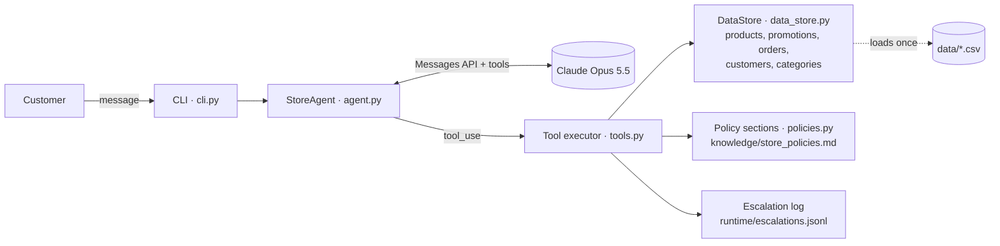

# Empório da Música — AI Customer-Service Agent

Prototype of a text-message customer-service agent for **Empório da Música**, a (fictional) musical-instrument store in Campo Grande/MS. Built for the Artefact *AI Engineer – Full-Stack para Aplicações com IA Generativa* technical case.

The agent ("Dó") answers customers in Brazilian Portuguese with the store's tone, looks up **live catalog, promotion, payment and order data** through deterministic Python tools, grounds **policy answers** in the official store manual, and handles out-of-scope requests, privacy and prompt-injection attempts.

```
Cliente: Vi que o Takamine GD20 estava com 12% de desconto, ainda tá valendo?
   🔧 get_product_details({"product_id": 95})
Dó:      Infelizmente não 😕 Ele teve mesmo uma "Oferta Especial" de 12%, mas essa promoção já
         acabou e hoje o violão está sem desconto. O preço atual é R$ 2.199,00 ...
```

| | |
|---|---|
| **Language** | Python 3.10+ |
| **LLM** | Claude Opus 5.5 (`claude-opus-5-5`) via the official Anthropic SDK |
| **Approach** | Function calling (tool use) + deterministic data tools + section-based policy retrieval |
| **Interface** | Terminal chat (CLI) |
| **Quality** | 60 unit tests (no network) + 13-case behavioral evaluation against the real model (13/13) |

---

## Table of contents

1. [Quick start](#quick-start)
2. [Architecture](#architecture)
3. [Technical decisions](#technical-decisions)
4. [Data treatment and findings](#data-treatment-and-findings)
5. [Assumptions](#assumptions)
6. [Testing and evaluation](#testing-and-evaluation)
7. [Example conversations](#example-conversations)
8. [Known limitations and what I would do with more time](#known-limitations-and-what-i-would-do-with-more-time)
9. [Use of AI coding assistants](#use-of-ai-coding-assistants)
10. [Project structure](#project-structure)

---

## Quick start

**Requirements:** Python 3.10+ and an Anthropic API key ([console.anthropic.com](https://console.anthropic.com)).

```bash
git clone https://github.com/GuilhermeCostaProenca/artefact-ai-engineer-challenge.git
cd artefact-ai-engineer-challenge

python -m venv .venv
# Windows: .venv\Scripts\activate    macOS/Linux: source .venv/bin/activate
pip install -r requirements.txt

cp .env.example .env        # Windows: copy .env.example .env
# edit .env and set ANTHROPIC_API_KEY=...
```

Run the chat:

```bash
python -m emporio_agent               # add --show-tools to see every tool call
```

Chat commands: `/nova` (new conversation), `/salvar [file.md]` (save transcript with tool calls), `/ferramentas` (toggle tool trace), `/sair`.

### Configuration (`.env`)

| Variable | Default | Purpose |
|---|---|---|
| `ANTHROPIC_API_KEY` | — | Required. Never committed (`.env` is git-ignored). |
| `EMPORIO_MODEL` | `claude-opus-5-5` | Any Claude model ID. |
| `EMPORIO_EFFORT` | `medium` | `low` / `medium` / `high` — reasoning depth vs. latency and cost. |
| `EMPORIO_NOW` | real clock | Freeze the store clock (ISO 8601, e.g. `2026-11-03T14:30:00`) for reproducible demos. |
| `EMPORIO_DATA_DIR` | `data` | Folder with the CSVs. |
| `EMPORIO_RUNTIME_DIR` | `runtime` | Escalation log and saved transcripts (git-ignored). |

### Other commands

```bash
python -m pytest                      # 60 unit tests, offline, ~2 s
python scripts/evaluate.py            # behavioral eval against Claude -> evals/report.md
python scripts/run_examples.py        # regenerate examples/*.md against Claude
```

---

## Architecture



**One turn, step by step**

1. The customer message is appended to the conversation history.
2. `StoreAgent` calls the Messages API with the system prompt (persona + business rules + current store time), the tool definitions and the full history.
3. Claude either answers directly (greeting, out-of-scope, a follow-up question) or emits one or more `tool_use` blocks.
4. Each tool call is validated and executed in plain Python against the in-memory data. Results go back to Claude as `tool_result` blocks, all in one message. Errors go back as `is_error: true` with a readable reason, so the model can recover by asking the customer or retrying with corrected arguments.
5. The loop repeats (up to 8 rounds) until Claude produces the final text, which is shown to the customer.

**Tools**

| Tool | What it does | Key rules enforced in code |
|---|---|---|
| `search_products` | Catalog search by text, category and price range | Accent/plural/punctuation-tolerant (`gd-20` = `GD20`); filters on the *current* (promotional) price; hides unavailable items unless asked |
| `get_product_details` | Description, specs, price, promotion | Lists **expired** promotions so the agent can say they ended; suggests in-stock **alternatives** for out-of-stock/discontinued items (policy 7.3) |
| `list_active_promotions` | All valid promotions | Only `is_active = 1`; always returns original price, % and promotional price (policy 6.2) |
| `get_payment_options` | PIX, debit, boleto, installments | PIX −5% only on non-promotional prices; installment minimums per band (3x/6x/12x); combined payment only above R$ 2,000 |
| `get_order_status` | Order status, items, tracking, delivery | Requires **order number + phone on file**; identical error for "wrong phone" and "no such order"; locks after 3 failures; returns first name only; computes overdue days and return/warranty windows |
| `get_store_policy` | Official manual text for 1+ topics | 9 fixed sections; the model chooses the topic, Python returns the exact text |
| `escalate_to_human` | Logs a ticket for the team | Returns a protocol and the 24-business-hour SLA from the manual |

---

## Technical decisions

### Agent approach: function calling over deterministic tools

The case asks the agent to *"know when to consult data and when to consult policies"*. With tool calling, that decision is made explicitly by the model and is visible in every transcript (each tool call is logged). The arithmetic and lookups stay in tested Python.

- **Why not a SQL agent?** Letting the model write queries means trusting generated code to compute prices, discounts and installments. The policy manual says incorrect prices "can constitute misleading advertising". Fixed functions are safer, easier to test and cheap to extend. The data is also tiny (65 products, 20 orders), so a database adds nothing.
- **Why not pure RAG?** Prices, stock and order status are structured data that change in real time. They should be looked up, not retrieved as text chunks.
- **Why not LangChain or LlamaIndex?** The loop is about 60 lines over the official SDK. A framework would hide the very logic this case evaluates and add dependencies without adding capability.
- **Why a manual loop instead of the SDK's beta Tool Runner?** Every step stays explicit: rollback on API errors, a round cap, and an injectable client, so the loop is unit-tested with a scripted fake model.

### Model and provider: Claude Opus 5.5

- Strong, reliable tool use and instruction following in Portuguese, which matters more here than raw speed.
- **Effort `medium`** (configurable). Adaptive thinking is always on in this model, and effort trades reasoning depth against latency and cost. In the evaluation, single-tool turns took about 2–9 s.
- **Prompt caching:** tools + system prompt form a stable prefix, frozen once per session (the timestamp is captured at session start), so later turns read it from cache.
- **Server-side refusal fallback** (`fallbacks: "default"`): if a safety classifier declines a request, the API retries it on a fallback model. If the whole chain refuses, the customer gets a polite redirection, not a crash.
- The model is one environment variable (`EMPORIO_MODEL`), so a cheaper model (e.g. `claude-haiku-5-5`) can be evaluated with `scripts/evaluate.py` before switching.

### Policy retrieval: sections, not embeddings

The manual is 8 pages (~3k tokens) and already organized by topic. I transcribed it into `emporio_agent/knowledge/store_policies.md`, split into 9 sections (`about_store`, `business_hours`, `payment_methods`, `returns_and_exchanges`, `shipping_and_delivery`, `promotions`, `warranty`, `privacy`, `service_procedures`). The model picks the topic(s) and receives the **exact source text**.

- Deterministic and auditable: the same topic always returns the same text, and a unit test checks that key facts from the PDF survived the transcription.
- No vector database, chunking or embedding model to tune, and no "retrieved the wrong chunk" failure mode.
- It scales well enough: with a manual 10–100× larger, I would switch to hybrid search (BM25 + embeddings) behind the same `get_store_policy` interface.

Transcribing by hand was itself a data decision: automatic PDF extraction scrambled two tables (business hours and company data). I rebuilt them, and I added clearly marked `[Nota de transcrição]` notes where the source contradicts itself (see below).

### Prompt strategy

The system prompt (`emporio_agent/prompts.py`) is organized by concern:

- **Persona and tone** from manual §7.1 ("informal but professional, like a friend who knows music").
- **When to consult what**: data tools for anything numeric or about stock or orders, the policy tool for rules, both for mixed questions.
- **Business rules** the model must apply when phrasing answers.
- **Scope**: accessories, off-topic requests.
- **Privacy and security**: LGPD, verification before order lookup, injection resistance.
- **Current store time**, so it can say "we're open until 18h today".

Rules that must *always* hold live in code, not only in the prompt (PIX not cumulative, installment minimums, phone verification). The prompt explains them; the tools enforce them.

### Conversation history

History is kept in memory for the session, in the exact form the API returns, which includes the thinking and tool blocks it needs on the next request. It is never edited, only appended to, which keeps the prompt cache valid. A failed turn (API error, refusal, runaway loop) is rolled back, so the history never ends on an unanswered message. `/salvar` exports a transcript. Persisting sessions across restarts was out of scope for a CLI prototype; see [limitations](#known-limitations-and-what-i-would-do-with-more-time).

### Security and privacy

- Order data requires **order number + phone on file** (the WhatsApp-style second factor). The same error is returned whether the order doesn't exist or the phone is wrong, so order numbers can't be enumerated. Lookups lock after 3 failed attempts per conversation.
- Tools never return email or phone, and only the customer's **first name**. There is no tool that lists customers, so the model cannot leak what it never receives.
- Tool inputs are validated (types, ranges, lengths, enums) before execution, and unknown tools are rejected. No model-generated code is ever executed.
- Customer messages and tool results are treated as data; the prompt instructs the model to ignore embedded instructions. This is checked in the evaluation and in example 5.
- The API key is read from `.env`, which is git-ignored.

---

## Data treatment and findings

The CSVs in `data/` are **unchanged copies** from the challenge archive. All cleaning happens in memory at load time: types are parsed, empty strings become `None`, specs JSON is parsed, and text is normalized for search.

Inspecting the data before coding surfaced several inconsistencies. Each one is handled deliberately:

| Finding | How the agent handles it |
|---|---|
| `bruno.martins@jmail.com` belongs to **two customers** (11 and 43) | Email can't identify a customer, so verification uses **order number + phone** |
| Product 96 (Giannini GF-3D) is `active` with **stock 0** | Reported as out of stock, with in-stock alternatives |
| Product 113 is `discontinued` but has a Black Friday promotion | Shown as out of catalog; inactive promotions are never applied |
| Product 130 is `coming_soon` yet appears in orders (one delivered) | Treated as not yet for sale; existing orders still display normally |
| Only 4 of 25 promotions are active; products 93, 96 and 99 have several | Only `is_active = 1` counts; if two were active, the larger discount wins (they're never cumulative) |
| Totals of orders 3 and 20 differ from current price × quantity | The registered `total_brl` is shown; prices may have changed since the order |
| Order 8 is `shipped`, ~248 days past its estimated delivery | The tool computes `delivery_overdue_days`; the agent apologizes and escalates |
| Categories 6, 7, 8 (woodwinds, brass, orchestral strings) have no products, while the manual claims "300+ instruments" | The catalog is the source of truth: "we don't have that right now", no invented items |
| The manual lists two numbers: (67) 3341-4444 as phone/WhatsApp and (67) 3321-4500 as the WhatsApp channel (§7) | Both are given in context (phone vs. WhatsApp service) |
| The manual's email appears with an accent in one table | The cover's unaccented form is used |
| Credit card table says "minimum installment R$ 100", while §3.1 defines bands | §3.1 (the detailed rule) is applied |

---

## Assumptions

The case allows reasonable assumptions as long as they are documented:

1. **Receipt date.** Orders have no actual receipt date, so `estimated_delivery` is used as a proxy for "received" in the 7-day return and 90-day warranty windows. The agent says this explicitly and tells the customer the team confirms final eligibility.
2. **Installments up to 3x.** "No minimum installment (except below R$ 50.00)" is read as a minimum installment of R$ 50.00 for 1–3x. With the current catalog (cheapest item R$ 159.90), both possible readings give the same result.
3. **Identity.** Knowing the order number plus the phone on file is enough to see that order, mirroring the store's WhatsApp channel.
4. **Partner stores.** The manual says to suggest partner stores for accessories "when possible", but no list exists, so the agent doesn't name any.
5. **Holidays** aren't in the data. The agent knows the weekday and time (Campo Grande, UTC-4, no DST) and warns that hours may change on holidays.
6. **Shipping outside Campo Grande** depends on CEP, weight and dimensions, which aren't available, so the agent never estimates those values.
7. **Online vs. in-store purchases.** The right of regret applies to online purchases. Orders don't record the channel, so the agent presents the rule as written and leaves confirmation to the team.

---

## Testing and evaluation

**Unit tests** (`tests/`, 60 tests, offline, ~2 s):

- `test_data_and_policies.py`: table loading, normalization, and that key facts from the PDF survived the transcription.
- `test_tools.py`: budget search, plural and punctuation matching, out-of-stock alternatives, active vs. expired promotions, PIX non-cumulativity, installment bands (parametrized), order lookup with several phone formats, **wrong phone vs. missing order indistinguishable**, **no access to another customer's order**, **no contact data in results**, lockout after 3 failures, escalation logging, and malformed tool inputs returning errors instead of raising.
- `test_agent.py`: the agent loop driven by a **scripted fake Claude client**. It covers tool results fed back with matching IDs, parallel calls in one message, invalid input becoming a tool error, request shape (cache, effort, fallback), multi-turn history, rollback on API errors and refusals, and the tool-round cap.

**Behavioral evaluation** (`scripts/evaluate.py` → [`evals/report.md`](evals/report.md)). Unit tests prove the tools are right; this checks that the *model* uses them correctly. It runs 13 single-turn cases against the real API. Each case asserts which tools must or must not be called and which facts must or must not appear in the reply: price lookups, hidden out-of-stock items, only active promotions, PIX not stacking with a promotion, the installment rule, store hours, no order lookup without a phone, someone else's order, a contact-data request, accessories, an empty category (no invented prices), off-topic requests and prompt injection. **Latest run: 13/13.**

A real bug found this way: in the first run of example 3, the agent said *"yes, you can return it"* before looking up the order, which turned out to be outside the 7-day window. The prompt now requires checking the customer's data before committing to an outcome (commit `fix(agent): avoid confirming eligibility before checking customer data`).

---

## Example conversations

Generated by `scripts/run_examples.py` against the real model with a frozen clock (Tuesday 03/11/2026, 14:30). Every tool call is included, collapsed, exactly as executed.

| File | Scenario |
|---|---|
| [`01-catalog-and-payment.md`](examples/01-catalog-and-payment.md) | "Which guitars up to R$ 1,000?" → installments and PIX for the chosen one |
| [`02-price-expired-promotion-and-store-info.md`](examples/02-price-expired-promotion-and-store-info.md) | Price of the Takamine GD20, an **expired** 12% promotion, an **out-of-stock** model with alternatives, address and Saturday hours |
| [`03-return-request-with-policy.md`](examples/03-return-request-with-policy.md) | **Non-trivial:** "I regret my purchase": verification, order lookup, return windows computed against the policy, then warranty |
| [`04-delayed-order-complaint.md`](examples/04-delayed-order-complaint.md) | **Non-trivial:** an order 248 days late, empathy and escalation with a protocol number |
| [`05-out-of-scope-and-privacy.md`](examples/05-out-of-scope-and-privacy.md) | Accessories, another customer's personal data, prompt injection, an off-topic request |

---

## Known limitations and what I would do with more time

| Limitation | With more time |
|---|---|
| CLI only | A thin HTTP API (FastAPI) as the integration point for WhatsApp Business, plus a small web chat. The `StoreAgent` class is already transport-agnostic. |
| History lives in memory, per process | Persist sessions keyed by the customer's phone (Redis or SQLite) with a TTL, and summarize or compact long conversations. |
| CSVs loaded at startup (a snapshot, not live) | Read from the store's real database or API, with caching. Tool signatures wouldn't change. |
| Order verification by phone only | One-time code sent by SMS or WhatsApp before showing order data; rate limiting per phone and IP across sessions, not only per conversation. |
| Escalations go to a local JSONL file | Push to a helpdesk (Zendesk, Freshdesk) or a team Slack channel, with SLA tracking. |
| Simple lexical product search | Synonyms ("violão de aço" ≈ "folk"), typo tolerance and semantic recommendations ("for a beginner playing MPB"), once the catalog grows. |
| Evaluation has 13 single-turn cases | Multi-turn scenarios, LLM-as-judge for tone and persona, cost and latency tracking per case, and running it in CI on every prompt change. |
| No real receipt date or holiday calendar | Add a `delivered_at` field and a holiday calendar to make windows and opening hours exact. |
| Policies transcribed manually | An ingestion step that re-generates the sections when the manual is updated, with a diff for human approval. |
| Single-language (pt-BR) | Detect language and answer in English or Spanish (the model already supports it; the prompt would need tone guidance). |

---

## Use of AI coding assistants

I used AI assistants throughout and want to be transparent about how:

1. **ChatGPT (OpenAI):** initial reading of the recruitment email and challenge, and a written handoff with context, requirements to verify and engineering guidelines.
2. **Claude Code (Anthropic, Claude Opus 5.5)** as a pair programmer for the implementation, in this order:
   - It **inspected the actual files first**: extracted the archive, read both PDFs and profiled the six CSVs with a script. That is how the data inconsistencies above were found.
   - It proposed the requirements checklist and the architecture. **I made the key decisions:** the LLM provider, function calling with section-based policies instead of RAG or a SQL agent, CLI first, and no orchestration framework.
   - It wrote the code incrementally: data layer → policies → tools → agent → CLI, with tests after each layer. I authorized each step and the commit structure (Conventional Commits, tests in separate commits).
   - Example conversations and the evaluation were **generated by running the real agent**, never written by hand. Reviewing them caught a real prompt issue, which was fixed and committed separately.
3. Verification: the prices, installments, dates and policy windows in the transcripts and the evaluation report were cross-checked against the CSVs and the manual.

The workflow that worked best was **AI for speed, human for decisions and verification**: inspect real data before designing, keep numeric logic deterministic and tested, and treat model output (including the assistant's own) as something to verify.

---

## Project structure

```
├── data/                          # original challenge files (unchanged)
├── emporio_agent/
│   ├── agent.py                   # tool-calling loop with Claude
│   ├── cli.py                     # terminal chat + transcript export
│   ├── config.py                  # settings from .env, store time zone
│   ├── data_store.py              # CSV loading into typed records
│   ├── policies.py                # section-based policy retrieval
│   ├── prompts.py                 # system prompt (persona + rules)
│   ├── tools.py                   # 7 deterministic tools + schemas + validation
│   └── knowledge/store_policies.md
├── evals/report.md                # latest behavioral evaluation
├── examples/                      # 5 real conversations
├── scripts/
│   ├── evaluate.py                # behavioral evaluation against the model
│   └── run_examples.py            # regenerates examples/
├── tests/                         # 60 offline unit tests
├── .env.example
├── pyproject.toml
└── requirements.txt
```
